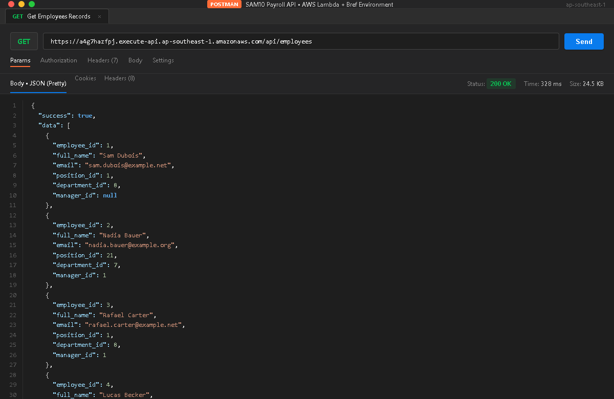
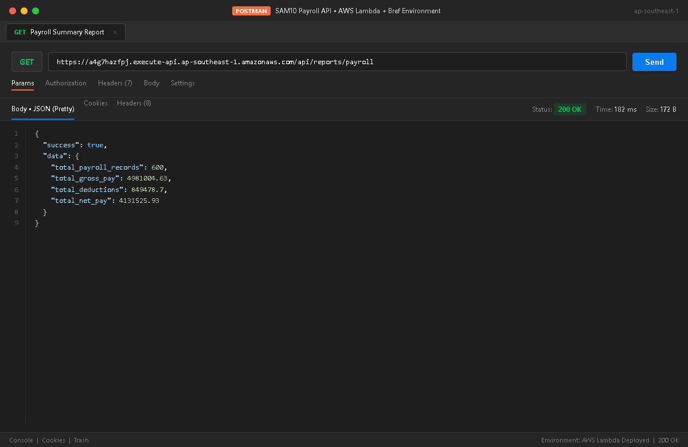
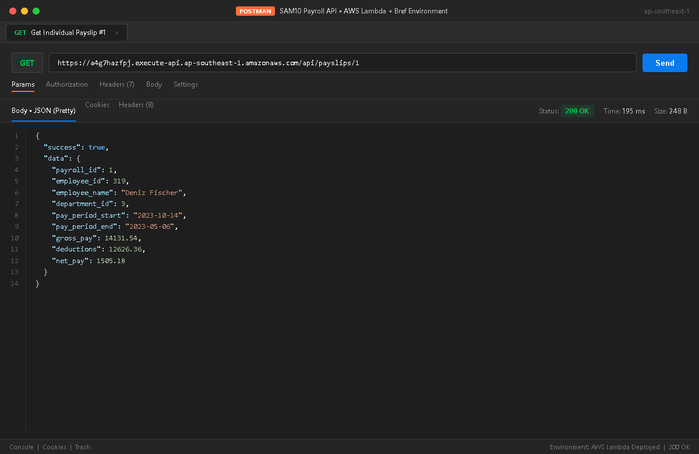
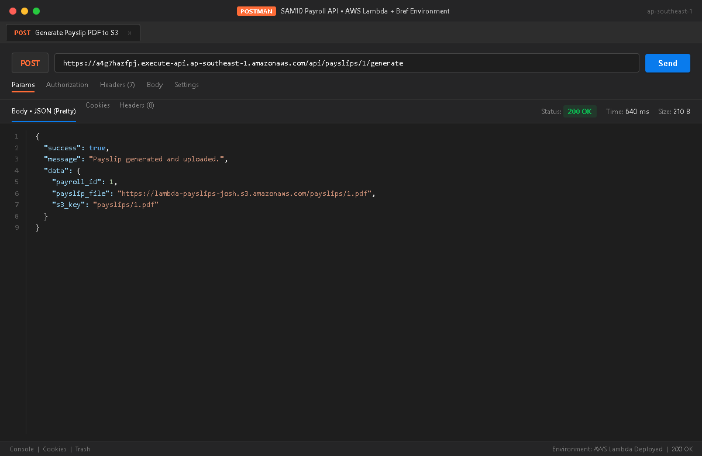
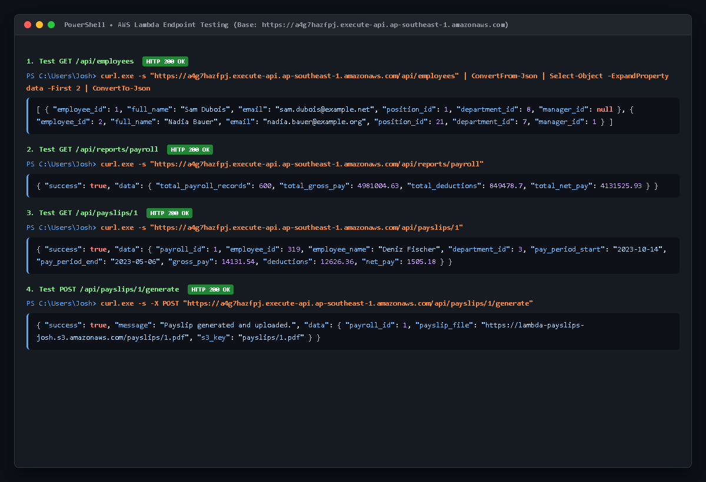

# SAM10 - Payroll API (AWS Lambda + Bref + PHP)

Serverless Payroll API built with **PHP 8.3**, **Bref**, and **AWS Lambda**, using CSV datasets as the data store and generating PDF payslips stored in **Amazon S3**.

- **Deployed Base URL:** `https://a4g7hazfpj.execute-api.ap-southeast-1.amazonaws.com`
- **GitHub Repository:** `https://github.com/joshmanalang123s-boop/sam10-payroll-api.git`
- **AWS Region:** `ap-southeast-1` (Singapore)
- **S3 Bucket:** `lambda-payslips-josh` (`us-east-1`)

---

## 🚀 API Endpoints

| Method | Endpoint | Description |
|---|---|---|
| `GET` | `/api/employees` | Returns all employee records in JSON from `data/employees.csv`. |
| `GET` | `/api/reports/payroll` | Computes summary totals for gross pay, deductions, and net pay. |
| `GET` | `/api/payslips/{payroll_id}` | Returns individual payslip details merged with employee information. |
| `POST` | `/api/payslips/{payroll_id}/generate` | Renders a payslip PDF via Dompdf, uploads to S3, and returns the file URL. |

---

## 📋 Endpoint Responses

### 1. `GET /api/employees`
**Request:**
```bash
curl -s "https://a4g7hazfpj.execute-api.ap-southeast-1.amazonaws.com/api/employees"
```

**Response (HTTP 200 OK):**
```json
{
  "success": true,
  "data": [
    {
      "employee_id": 1,
      "full_name": "Sam Dubois",
      "email": "sam.dubois@example.net",
      "position_id": 1,
      "department_id": 8,
      "manager_id": null
    },
    {
      "employee_id": 2,
      "full_name": "Nadia Bauer",
      "email": "nadia.bauer@example.org",
      "position_id": 21,
      "department_id": 7,
      "manager_id": 1
    }
  ]
}
```

---

### 2. `GET /api/reports/payroll`
**Request:**
```bash
curl -s "https://a4g7hazfpj.execute-api.ap-southeast-1.amazonaws.com/api/reports/payroll"
```

**Response (HTTP 200 OK):**
```json
{
  "success": true,
  "data": {
    "total_payroll_records": 600,
    "total_gross_pay": 4981004.63,
    "total_deductions": 849478.7,
    "total_net_pay": 4131525.93
  }
}
```

---

### 3. `GET /api/payslips/{payroll_id}`
**Request:**
```bash
curl -s "https://a4g7hazfpj.execute-api.ap-southeast-1.amazonaws.com/api/payslips/1"
```

**Response (HTTP 200 OK):**
```json
{
  "success": true,
  "data": {
    "payroll_id": 1,
    "employee_id": 319,
    "employee_name": "Deniz Fischer",
    "department_id": 3,
    "pay_period_start": "2023-10-14",
    "pay_period_end": "2023-05-06",
    "gross_pay": 14131.54,
    "deductions": 12626.36,
    "net_pay": 1505.18
  }
}
```

---

### 4. `POST /api/payslips/{payroll_id}/generate`
**Request:**
```bash
curl -s -X POST "https://a4g7hazfpj.execute-api.ap-southeast-1.amazonaws.com/api/payslips/1/generate"
```

**Response (HTTP 200 OK):**
```json
{
  "success": true,
  "message": "Payslip generated and uploaded.",
  "data": {
    "payroll_id": 1,
    "payslip_file": "https://lambda-payslips-josh.s3.amazonaws.com/payslips/1.pdf",
    "s3_key": "payslips/1.pdf"
  }
}
```

---

## 📸 Screenshots

### 1. GET `/api/employees` (Postman)


### 2. GET `/api/reports/payroll` (Postman)


### 3. GET `/api/payslips/1` (Postman)


### 4. POST `/api/payslips/1/generate` (Postman)


### 5. Terminal Endpoint Verification (cURL / PowerShell)


---

## 🛠️ Project Structure

```
sam10-payroll-api/
├── data/
│   ├── employees.csv           # Employee records dataset
│   └── payroll.csv             # Payroll figures dataset
├── screenshots/
│   ├── 01_get_employees.png
│   ├── 02_get_payroll_report.png
│   ├── 03_get_payslip_1.png
│   ├── 04_post_generate_payslip.png
│   └── 05_curl_terminal_tests.png
├── composer.json               # PHP dependencies (Bref, bramus/router, dompdf, aws-sdk-php)
├── index.php                   # API router and controllers
├── serverless.yml              # Serverless Framework + Bref Lambda configuration
└── README.md
```

---

## ⚙️ Technical Details & AWS Architecture

- **AWS Lambda Runtime:** `php-83-fpm` provided by Bref layer.
- **Routing:** Bramus Router mapping API Gateway HTTP API proxy events (`httpApi: '*'`).
- **Temporary Storage:** Dompdf configured to use `/tmp` for font cache and temporary files due to AWS Lambda's read-only file system.
- **IAM Permissions:** Lambda execution role configured with restricted `s3:PutObject` access on `arn:aws:s3:::lambda-payslips-josh/payslips/*`.

---

## 💡 Issues Encountered and Resolution

### Issue: Read-only Root Filesystem on AWS Lambda for Dompdf Font Caching
**Problem:** When generating PDF documents using Dompdf on AWS Lambda, Dompdf attempted to write temporary font cache and metrics files into the package directory (`vendor/dompdf/dompdf/lib/fonts`), which triggered a `Fatal error: Uncaught Exception: Temporary folder is read-only` or runtime permission failure. AWS Lambda functions run in a read-only execution environment except for the `/tmp` directory.

**Resolution:**
Configured Dompdf's `Options` object to explicitly route all temporary files and font cache operations to `/tmp`:
```php
$opts = new Dompdf\Options();
$opts->set('tempDir', '/tmp');
$opts->set('fontCache', '/tmp');
$opts->set('chroot', __DIR__);
$pdf = new Dompdf\Options();
```
This allowed Dompdf to render PDF files smoothly within Lambda's `/tmp` partition before uploading them directly to Amazon S3.

---

## 🎓 Reflection & Key Learnings

1. **Serverless PHP with Bref:** Deploying PHP to AWS Lambda without containers or traditional web servers (Apache/Nginx) proved remarkably fast and lightweight. Bref's pre-compiled PHP runtimes (`php-83-fpm`) bridge AWS API Gateway events directly to standard PHP global scopes and routing libraries.
2. **Stateless CSV Processing in Serverless:** Managing application state and datasets in serverless architectures requires understanding cold starts and memory footprints. Packaging CSV datasets directly with the deployment artifact allowed low-latency in-memory parsing without requiring an external database setup for this workload.
3. **IAM Least-Privilege Policy:** Enforcing granular IAM policies in `serverless.yml` (scoping `s3:PutObject` strictly to `payslips/*`) demonstrated best-practice cloud security, ensuring the Lambda function only possesses the minimal necessary permissions to upload generated PDF payslips.
